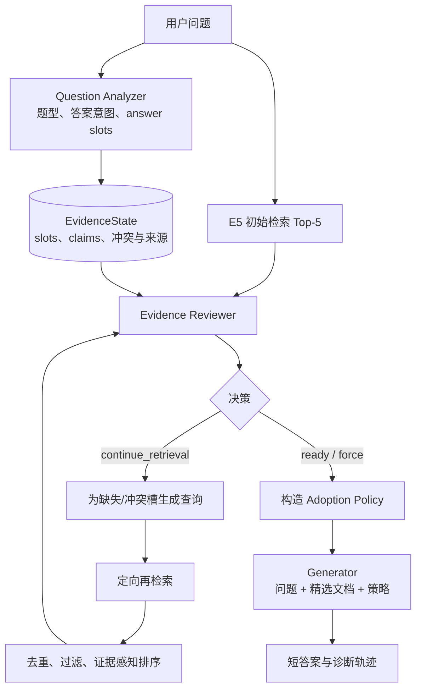

# Reviewer RAG：面向冲突感知与自适应检索的元认知RAG框架

## 初步结果

下表为基于 Qwen2.5-7B-Instruct 的 EM/F1 指标（%）。

| 方法                   |            HotpotQA |               MuSiQue |     2WikiMultiHopQA |             Bamboogle |
| -------------------- | ------------------: | --------------------: | ------------------: | --------------------: |
| Naive RAG            |        31.2 / 42.37 |          10.8 / 18.44 |        26.4 / 33.20 |          20.8 / 29.79 |
| IRCoT                |        27.3 / 40.57 |          11.4 / 19.95 |                   — |          22.4 / 35.21 |
| Iter-RetGen          |        33.3 / 45.11 |          14.7 / 22.80 |        29.3 / 36.29 |          20.8 / 30.08 |
| CRAG                 |        33.2 / 43.15 |          10.2 / 18.11 |        25.2 / 33.31 |          24.8 / 32.74 |
| **Reviewer RAG**     |    **36.1 / 47.88** |      **19.4 / 26.93** |    **30.0 / 37.40** |      **32.0 / 41.27** |
| **相对最佳基线提升 (EM/F1)** | **+8.41% / +6.14%** | **+31.97% / +18.11%** | **+2.39% / +3.06%** | **+29.03% / +17.21%** |

Reviewer RAG 在所有数据集上均取得最佳性能，其中在 MuSiQue 和 Bamboogle 上提升最显著（平均分别提升 25.04% 和 23.12%）。
这主要得益于 reviewer 机制对复杂多跳推理中的检索噪声和错误链路进行有效校验与修正，尤其适用于 MuSiQue 的多步组合推理和 Bamboogle 的高事实关联场景。在 HotpotQA 和 2WikiMultiHopQA 上，尽管基线性能较高，Reviewer RAG 仍保持稳定提升，验证了该机制在不同多跳问答任务中的有效性。

## 架构设计

框架核心包含一个位于检索阶段与生成阶段之间的元认知审查模块（Metacognitive Reviewer）。系统首先对问题进行结构化分析，将复杂问题分解为若干与最终答案相关的证据需求单元（answer slots），随后从候选文档中抽取原子化证据信息，并建立问题需求与证据单元之间的对应关系。审查模块依据证据支持情况动态维护当前证据状态，包括信息缺失（missing）、部分覆盖（partial）、充分支持（supported）以及证据冲突（conflicted）等类型。

基于证据状态评估结果，框架能够自主决定后续处理策略。当检测到关键证据缺失或存在明显冲突时，元认知审查模块将生成针对性检索意图，对不足部分进行定向补充检索；当证据达到充分覆盖条件时，则停止检索过程，并生成用于指导回答生成的可信证据采信策略。

在整体机制上，该框架形成“问题分析—证据审查—自适应检索—策略引导生成”的闭环流程。通过将证据状态建模与检索决策显式化，该方法使 RAG 系统由被动的信息调用模式转变为受证据状态驱动的主动检索模式。

## 限制与阶段

这些结果仍属于本地研究原型证据，而非定论：实验主要基于单一模型、单一种子和有限样本。项目目前已具备可复现实验、状态追踪和错误分析能力，但仍处于机制验证与消融阶段，距离稳定、低成本的生产系统尚有明显距离。
